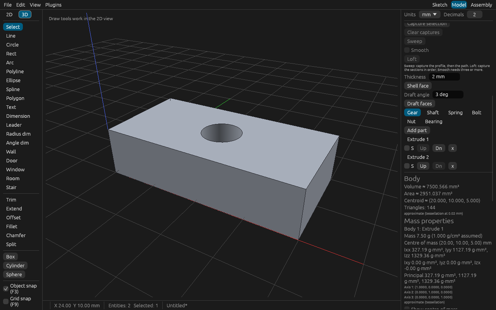

# ProjectCAD

A CAD program written in Rust: 2D drafting with constraints, parametric 3D modelling, architecture, mechanical assemblies and engineering analysis.



## Features

2D drafting and constraints (Phases 1 and 2):
- Lines, circles, arcs, polylines, ellipses, splines, polygons, text, dimensions and leaders; layers with line types and weights
- Snapping, typed coordinates, trim, extend, offset, fillet, chamfer, arrays, hatches and groups
- Constraints (horizontal, parallel, tangent, equal and more) with a sparse solver, and parameters with units and expressions
- DXF and SVG import; DXF, SVG and PDF export

Parametric 3D (Phase 3):
- Extrude, revolve, sweep, loft, shell, fillet, chamfer, patterns, mirror and draft in an editable feature list
- Sketches on planes and on faces; sections; face and edge selection
- Mesh booleans on the tessellation, with volumes labelled approximate when faces are curved

Architecture (Phase 4):
- Levels, walls with automatic joins, doors, windows, rooms, floors, roofs and stairs
- Plan and 3D views of several floors; IFC4 export

Mechanical parts and assemblies (Phase 5):
- Gears, shafts, springs, bolts, nuts with modelled threads, and ball bearings as features
- Components, joints, exploded views, bill of materials, interference and clearance checks

Engineering analysis (Phase 6):
- Mass properties, motion studies with joint limits and closed loops, and static linear-elastic finite element studies with a safety factor
- Every result is labelled exact, approximate or validated; see [docs/VALIDATION.md](docs/VALIDATION.md)

Production (Phase 7):
- Fast assemblies (parallel placement, instanced drawing) and analysis jobs that run in the background
- Export to STL, OBJ, STEP, glTF, 3MF and IFC; STL and OBJ import
- Docked panels, light and dark themes, command search, a rotate gizmo and joint drags
- Plugins: separate programs that edit the document through MCP

See the [user guide](docs/USER_GUIDE.md) for how to use all of this, and [Keyboard and mouse](docs/USER_GUIDE.md#keyboard-and-mouse) for the shortcuts.

## Install from a release

Download the archive for your system from the [GitHub Releases page](https://github.com/lucas-s-b/ProjectCAD/releases):

- `ProjectCAD-v0.2.0-windows-x86_64.zip`
- `ProjectCAD-v0.2.0-linux-x86_64.zip`
- `ProjectCAD-v0.2.0-macos-arm64.zip`

Each archive holds `cad-app` (`cad-app.exe` on Windows), `LICENSE` and `README.md`. Unzip it and run the program.

Notes:
- The binaries are not signed. On Windows, SmartScreen shows a warning: click "More info", then "Run anyway". On macOS, run `xattr -d com.apple.quarantine cad-app` once.
- Linux needs the X11 or Wayland libraries (`libxkbcommon`, `libwayland`, `libx11`, `libxcb`) and a GPU driver with Vulkan or OpenGL (the renderer is wgpu).
- There is no Intel macOS build.

## Build from source

1. Install [Rust](https://rustup.rs) (stable, edition 2024) with rustup.
2. On Linux, install the GUI libraries first: `sudo apt-get install -y libxkbcommon-dev libwayland-dev libx11-dev libxcb1-dev`.
3. Get the code and run:

```bash
git clone https://github.com/lucas-s-b/ProjectCAD.git
cd ProjectCAD
cargo run --release -p cad-app
```

The first build takes a few minutes. No other tools are needed.

## Run the tests

```bash
cargo test --workspace
cargo clippy --workspace --all-targets -- -D warnings
```

Neither opens a window. CI runs both on Windows, Linux and macOS.

End-to-end scripts in `tests/` drive the app through MCP. Build first, then run one script or all of them:

```bash
cargo build -p cad-app -p cad-bench && cargo build -p cad-plugin-api --examples
bash tests/mcp_smoke.sh
for s in tests/mcp_*.sh; do bash "$s" || echo "FAIL $s"; done
```

The scripts start `target/debug/cad-app.exe --mcp --background`, an off-screen window driven over MCP with no OS mouse or keyboard input. They need a GPU, run in Git Bash on Windows (they call `cad-app.exe`) and are not part of CI. `SHOTS=docs/images bash tests/mcp_docs_shots.sh` remakes the screenshots of the user guide.

Benchmarks: `cargo run --release -p cad-bench` (see [docs/BENCHMARKS.md](docs/BENCHMARKS.md)). Validation report: `cargo run --release -p cad-bench -- validate` (see [docs/VALIDATION.md](docs/VALIDATION.md)).

## Documentation

- [docs/USER_GUIDE.md](docs/USER_GUIDE.md): how to use the program, by task
- [docs/DESIGN.md](docs/DESIGN.md): architecture and technical decisions
- [docs/ROADMAP.md](docs/ROADMAP.md): what each phase delivered and what is not done
- [docs/VALIDATION.md](docs/VALIDATION.md): validation benchmarks for the analysis results
- [docs/BENCHMARKS.md](docs/BENCHMARKS.md): performance measurements
- [docs/PLUGINS.md](docs/PLUGINS.md): plugin developer guide
- [CHANGELOG.md](CHANGELOG.md): changes per release

## Automation and plugins

`cad-app --mcp` serves MCP over stdin and stdout; `--background` keeps its window off-screen. Plugins are separate programs that talk to the app this way; see [docs/PLUGINS.md](docs/PLUGINS.md).

## License

MIT, see [LICENSE](LICENSE).
