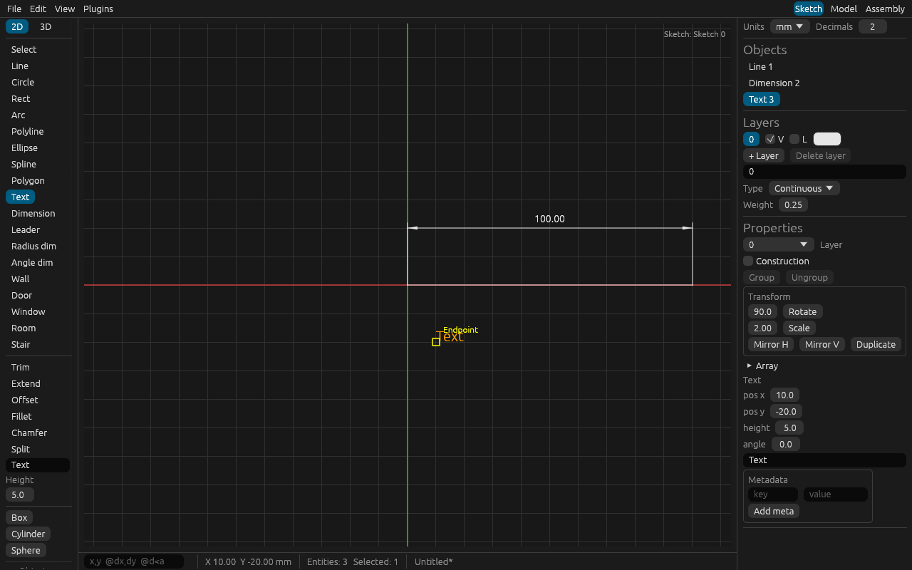
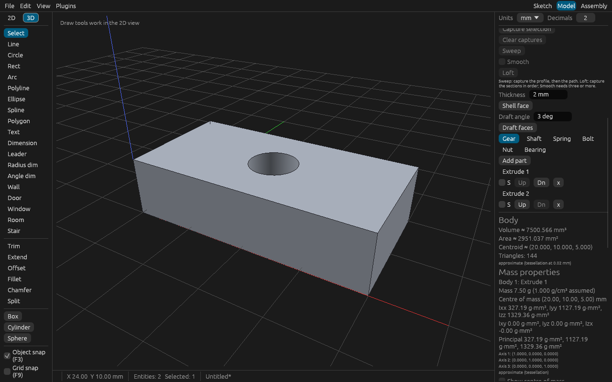
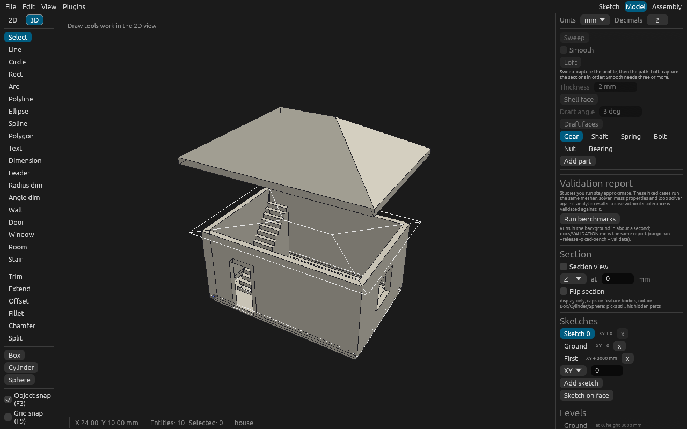
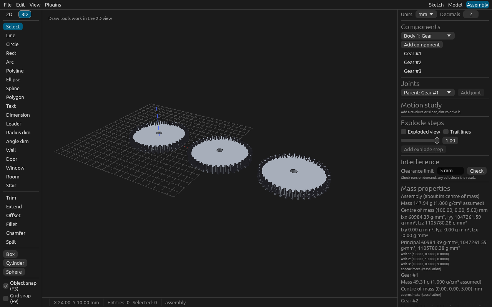
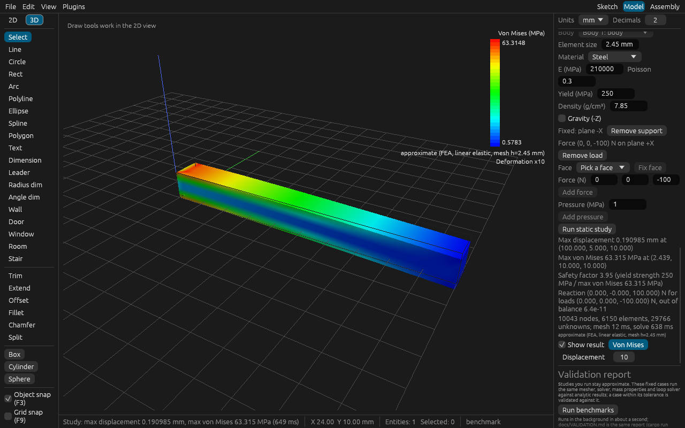
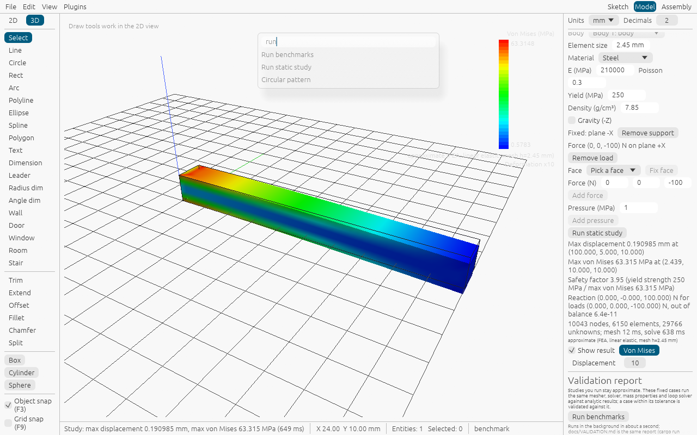

# ProjectCAD user guide (v0.2.0)

ProjectCAD is a CAD program for 2D drafting with constraints, parametric 3D parts, architecture, mechanical assemblies and engineering analysis. It runs on Windows, Linux and macOS. All lengths are in millimetres unless a field says otherwise; the display unit can be changed per project.

- [Install and run](#install-and-run)
- [The window](#the-window)
- [2D drafting](#2d-drafting)
- [Constraints and parameters](#constraints-and-parameters)
- [Parametric 3D](#parametric-3d)
- [Architecture](#architecture)
- [Mechanical parts and assemblies](#mechanical-parts-and-assemblies)
- [Analysis](#analysis)
- [Import and export](#import-and-export)
- [Plugins](#plugins)
- [Settings, themes and command search](#settings-themes-and-command-search)
- [Construction lines and parallel snap](#construction-lines-and-parallel-snap)
- [Grab, rotate and scale](#grab-rotate-and-scale)
- [Transform by points and stretch](#transform-by-points-and-stretch)
- [Keyboard and mouse](#keyboard-and-mouse)
- [More documentation](#more-documentation)

## Install and run

Use this section to start the program.

1. From a release: download the archive for your system from the project's GitHub Releases page, unzip it and run `cad-app` (`cad-app.exe` on Windows). The [README](../README.md) lists the archive names.
2. From source: install Rust with rustup, then run `cargo run --release -p cad-app` in the repository.
3. Projects are saved as `.cadproj` files (JSON, project file format 28). Files from older versions open.
4. The app keeps its own settings (theme, accent colour, panel layout, plugins) in a settings file, never in a project. The file is `%APPDATA%\ProjectCAD\settings.json` on Windows, `$XDG_CONFIG_HOME/projectcad/settings.json` or `~/.config/projectcad/settings.json` elsewhere. Set the environment variable `CAD_SETTINGS` to a file path to use another file.

Limits: the release binaries are not signed, and Linux needs a GPU driver with Vulkan or OpenGL.

More: [README](../README.md) (install notes), [PLUGINS.md](PLUGINS.md) (settings folder).

## The window

Use this section to find your way around.

1. The menu row has **File**, **Edit**, **View** and **Plugins**. At its right are three tabs, **Sketch**, **Model** and **Assembly**, which choose the panel shown at the side.
2. The tool column on the left starts with **2D** and **3D**, which switch the main view. Below are the draw tools, the edit tools, the solid buttons (**Box**, **Cylinder**, **Sphere**) and the snap switches **Object snap (F3)** and **Grid snap (F9)**.
3. The main area is the 2D view (the active sketch) or the 3D view (all bodies, components and levels). **Fit** in the **View** menu, or the F key, fits the view to the model.
4. The **Sketch** panel holds the object list, layers, properties and constraints. The **Model** panel holds parameters, features, bodies, analysis and sketches. The **Assembly** panel holds components, joints, motion, explode steps, interference and the bill of materials.
5. To move a panel, open **View** and click **Left**, **Right** or **Bottom** in the row named after the panel (for example `Model: Left`). The checkboxes `Left panel`, `Right panel` and `Bottom panel` show or hide a slot. Drag the edge of a slot to resize it. **Reset layout** restores the default: all three panels on the right.
6. The status bar at the bottom has the coordinate field, the cursor position, the entity count, the selection count and the project name. Messages from the last action appear there.
7. Long analysis jobs run in the background. The status bar then shows `Running <job>: <seconds> s` and a **Cancel job** button.

Limits: panels dock to fixed slots chosen in the **View** menu. There is no drag-and-drop docking, no floating window and no tab strip.

More: [ROADMAP.md](ROADMAP.md) (batch D).

## 2D drafting

Use this section to draw and edit flat geometry in a sketch.

1. Click **2D**, then pick a tool: **Line**, **Circle**, **Rect**, **Arc**, **Polyline**, **Ellipse**, **Spline** or **Polygon**. Click the points the tool needs in the view (for a line: start, end). Esc cancels the tool.
2. To type a point instead of clicking, enter `x,y`, `@dx,dy` or `@d<a` in the coordinate field in the status bar, then press Enter. `@` means relative to the last point; `d<a` is a distance and an angle in degrees.
3. Snapping: switch **Object snap (F3)** and **Grid snap (F9)** on or off. Object snap finds endpoints, midpoints, centres, intersections, and perpendicular and tangent points. Hold Shift while drawing to snap the direction to 15 degree steps (only when no object snap is hit).
4. To select, use **Select** and click an entity, or click its name in the **Objects** list. Shift+click adds to or removes from the selection. Left-drag a selected entity to move it (snapped). Press Delete to delete.
5. **Properties** (Sketch panel) edits the selection: the **Layer**, **Construction** (construction geometry is drawn but not used as a profile), **Group** and **Ungroup**, and the numeric fields of the shape. **Transform** has **Rotate** (angle field), **Scale** (factor field), **Mirror H**, **Mirror V** and **Duplicate**. **Array** makes rectangular or polar arrays. **Metadata** stores key and value pairs on an entity (used for IFC properties).
6. Edit tools: **Trim**, **Extend**, **Offset**, **Fillet**, **Chamfer** and **Split**. Offset, fillet and chamfer take a distance or radius from the field under the tool list.
7. Annotations: **Text** (type the text in the **Text input** field first), **Dimension** (click both points, then click where the dimension line goes), **Leader**, **Radius dim** (with a **Diameter** checkbox) and **Angle dim**. Linear dimensions follow their points when the geometry moves.
8. Layers: the **Layers** section lists layers with **V** (visible) and **L** (locked), a colour, a line **Type** (continuous, dashed, hidden, center) and a line **Weight**. **+ Layer** adds one and **Delete layer** removes the current one.
9. **Hatch** fills a closed boundary with lines, cross lines or a solid fill; choose the **Hatch pattern**, **Hatch angle** and **Hatch spacing** first.
10. **Units** and **Decimals** at the top of the side panel set the display unit (mm, cm, m, in, ft) and the number of decimals.

Limits: no blocks, no infinite construction lines, no stretch, no user coordinate systems, no hatch islands, and no true DXF dimension entities. See "Beyond the roadmap" in [ROADMAP.md](ROADMAP.md).

More: [DESIGN.md](DESIGN.md).

## Constraints and parameters

Use this section to make a sketch follow rules.

1. Select one or two lines, circles or arcs in the 2D view. The **Constraints** section of the Sketch panel then shows the buttons that fit the selection. One line: **Horizontal**, **Vertical**, **Length**, **Fix**. One circle or arc: **Radius**, **Diameter**, **Fix**. Two lines: **Parallel**, **Perpendicular**, **Equal**, **Collinear**, **Angle**. Two circles or arcs: **Concentric**, **Equal**, **Tangent**. Mixed or any two entities may also offer **Point on line**, **Point on circle** and **Coincident**. Two circles or arcs and a line offer **Symmetric**.
2. The solver runs after every change and the result is one undo step. The status line under the heading reads **Fully constrained**, `Under-constrained (<n> DOF)` or `Over-constrained (<n> redundant)`. An inconsistent set of constraints is refused.
3. Each constraint is listed with an **x** button to remove it. A constraint with a value (length, radius, diameter, angle) has a field: type a number, or an expression such as `w / 2`. Entities follow when the value changes. Angles are in degrees.
4. **Constraint glyphs** in the **View** menu shows or hides the constraint symbols in the 2D view.
5. Parameters live in the **Parameters** section of the **Model** panel. Type a name in **Param name** and an expression in **Param expression**, then click **Add**. Expressions have units (`5 mm`, `30 deg`), functions, conditionals and other parameters. A cycle or an unknown name shows an error under the parameter. Parameters can be used in constraint values, feature fields, part fields and joint values.

Limits: constraints work on lines, circles and arcs only (not rectangles or polylines). The solver is Levenberg-Marquardt on sparse equations.

More: [DESIGN.md](DESIGN.md) (constraints).

## Parametric 3D

Use this section to build solid parts from sketches. The model is a list of features; changing an early feature or a parameter rebuilds what depends on it.

1. Draw a closed shape (rectangle, circle, polyline) in the 2D view and select it.
2. Open the **Model** tab. Set **Distance** (an expression, for example `t`), **Taper** (a draft angle), **Operation** and **Target**, then click **Extrude**. The operation is `Add`, `Cut`, `Intersect` or **New body**. **Revolve** uses **Angle** and **Axis** instead of the distance. **Flip** reverses the direction.
3. **Sweep**: select a profile, click **Capture selection**, select the path, click **Capture selection** again, then click **Sweep**. **Loft**: capture two or more sections in order, then click **Loft** (**Smooth** needs three or more). **Clear captures** empties the list.
4. **Fillet edges** and **Chamfer edges** take a **Size**. Click the button, click edges of a body in the 3D view, then press Enter. **Shell face** hollows the selected body by a **Thickness** (open on a picked planar face). **Draft faces** leans picked planar faces by the **Draft angle**.
5. **Linear pattern**, **Circular pattern**, **Mirror feature** and **Mirror bodies** work on the selected feature or on all bodies.
6. Sketches: the **Sketches** section lists sketches. Choose a **Base plane** (XY, XZ, YZ) and an offset, then **Add sketch**. **Sketch on face** lets you click a planar face of a body in the 3D view; the new sketch sits on that face and follows it when the part changes.
7. The feature list shows each feature with **S** (suppress), **Up**, **Dn** and **x** (delete). Click a feature to edit it in **Selected feature**; the editor shows what it uses (`Uses: <features>`). A feature that fails shows its error and the rest of the model still rebuilds. The **Body** section shows volume, area, centroid and triangle count.
8. Faces and edges: click a face in the 3D view to see its surface kind and area; click an edge to see its kind, length or radius. **Section view** (**Section** section) cuts the model by a plane: choose the axis, an `at` offset and **Flip section**. The cut is display only.
9. **Mass properties** (Model panel) gives volume, mass (1 g/cm³ assumed for bodies), centre of mass, inertia and principal axes. **Show centre of mass** draws a marker.
10. In the 3D view, a selected **Box**, **Cylinder** or **Sphere** has a translate gizmo: drag an arrow along its axis.
11. To bring in a mesh, use **File** > **Import STL/OBJ mesh...**. The mesh becomes a feature in the list (one undo step).

Accuracy labels appear beside results: `exact: all faces are planar` or `approximate (tessellation at 0.02 mm)` under the **Body** section.

Limits: booleans run on a mesh (0.02 mm), so curved faces take part as facets. Ellipses and splines cannot be part of a profile. Fillets and chamfers do not blend corners where filleted edges meet. Faces that tilt, split or merge are not tracked by face references. Imported meshes must be closed. See [ROADMAP.md](ROADMAP.md) for the full limits.

More: [DESIGN.md](DESIGN.md) (kernel), [ROADMAP.md](ROADMAP.md).

## Architecture

Use this section to model a building: levels, walls, openings, rooms, floors, roofs and stairs.

1. Add a level: in the **Levels** section of the **Model** tab set **Elevation** and **Height**, then click **Add level**. Each level is a sketch on the XY plane. **Apply to level** gives a new storey height to the walls and stairs that still have the old one. **Active level**, **Level below** and **All levels** choose what the plan view shows.
2. Walls: pick **Wall** in the 2D view, set **Thickness** and the alignment, then click the corners. Each click ends one wall and starts the next; Esc stops. Wall ends join automatically (L, T and X joins, and hubs where three or more meet).
3. Doors and windows: pick **Door** or **Window**, set its **Width**, **Height** and **Sill**, then click inside a wall. The opening belongs to the wall: it follows when the wall moves. Edit its position along the wall in **Properties**.
4. Rooms: pick **Room** and click inside an area enclosed by walls. The room gets a name, a number, a net area and a perimeter; edit them in the **Rooms** list.
5. Floors and roofs: select a room or a closed curve. In **Properties**, the **Floor** group has **Thickness** and **Make floor**; the **Roof** group has the kind (`Flat`, `Shed`, `Gable`, `Hip`), **Pitch**, **Thickness**, **Overhang** and **Make roof**.
6. Stairs: pick **Stair**, click the start point and the direction. **Width**, **Max riser** and **Tread** set the flight; the number of risers follows the level height.
7. The 3D view shows every level at its elevation. Wall solids have their openings cut out.
8. For BIM data, add metadata keys of the form `Pset_Name.Property` to an entity; they become IFC property sets. Export with **File** > **Export IFC...**.

Limits: roofs on concave outlines (gable and hip), dormers, stairs with landings or railings, openings in slabs, plan cut height and dragging openings are not available. IFC export needs levels on the XY plane. See [ROADMAP.md](ROADMAP.md) (Phase 4 limits).

More: [DESIGN.md](DESIGN.md) (architecture), [ROADMAP.md](ROADMAP.md).

## Mechanical parts and assemblies

Use this section to make machine parts, place them as components and move them with joints.

1. Parts: in the **Model** panel pick `Gear`, `Shaft`, `Spring`, `Bolt`, `Nut` or `Bearing`, then click **Add part**. The part is a feature; edit its parameters in **Selected feature**. Gears take module, teeth, pressure angle, face width and bore. Shafts take steps (**Add step**, **Remove step**) and a chamfer. Bolts and nuts are ISO metric, M3 to M24; **Modelled thread** swaps the cosmetic thread for a real one. Bearings are deep groove ball bearings of the 60 and 62 series. Every parameter is an expression.
2. Components: open the **Assembly** tab, choose a body in **Component body** and click **Add component**. One body can be placed any number of times. Edit name, position, rotation, material, part number and **Grounded** in **Selected component**. **Delete component** removes it. A body that has components is drawn through them.
3. Bill of materials: the **Bill of materials** section groups components by designation and lists quantity and mass. Export it with **File** > **Export BOM CSV...**.
4. Joints: select a component, choose a parent in **Joint parent** and click **Add joint**. A joint is `Fixed`, `Revolute` or `Slider`; set its type in **Joint type**. Each side has a frame (origin and axis), typed or taken from a clicked face. **Limits** sets a minimum and maximum. **Closes loop** and **Free joint** make closed kinematic loops (linkages), which the app solves.
5. To move a joint by hand, use **Drag** in the joint editor: a slider and a value. The 3D view shows the pose while you drag, and the value is written when you let go.
6. Gizmos: select a free component in the 3D view. Three arrows move it; three rings (X, Y, Z) turn it about its centre; hold Shift to snap the turn to 15 degrees. A component whose parent joint is revolute or slider shows one handle instead: a ring about the joint axis or an arrow along it. Each drag is one undo step.
7. Exploded views: **Explode steps** lists steps that move one component along a direction. Turn on **Exploded view** and use the **Explode slider**; **Trail lines** draws the paths. **Add explode step** adds a step. The view is display only.
8. Interference: in **Interference** set a **Clearance limit** and click **Check**. Overlaps show in red; contact and clearance are listed. The result is dropped by any edit.
9. Motion study: choose a revolute or slider joint, a **from** and **to** value and the number of steps, then click **Run study**. **Check collisions** also finds the first colliding step. Play the result with the step slider and **Pause**; **Export motion CSV** saves a traced point.

Limits: gears have no undercut, profile shift or helical teeth; springs have plain ends; fasteners have no head chamfer or washer face; bearings have no cage; thread run-out and left-hand threads are not modelled. Components cannot reference other project files. Interference and collisions are measured on facets. See "Beyond the roadmap" in [ROADMAP.md](ROADMAP.md).

More: [DESIGN.md](DESIGN.md), [ROADMAP.md](ROADMAP.md) (Phase 5 and 6).

## Analysis

Use this section to check a part for stiffness and stress. The analysis is static, linear elastic and small-displacement.

1. Open the **Model** tab and click **New static study**. Choose the body, an **Element size** and a **Material**. **E (MPa)**, **Poisson**, **Yield (MPa)** and `Density (g/cm³)` fill in from the material table; editing them switches the material to **Custom**. **Gravity (-Z)** adds the body's weight.
2. Pick a face: click it in the 3D view or choose it in **Face**. Then click **Fix face** to make it a support (all of its displacements are held), **Add force** (the **Force (N)** fields X, Y, Z) or **Add pressure** (**Pressure (MPa)**). Supports and loads are listed with **Remove support** and **Remove load**.
3. Click **Run static study**. It runs in the background, one job at a time; any edit to the document drops the job. The status bar shows the maximum displacement and the maximum von Mises stress.
4. The results list the maximum displacement and stress with their locations, the safety factor (yield strength divided by the largest nodal von Mises stress), the support reactions and the mesh size. **Show result** draws the deformed body; **Von Mises** and **Displacement** choose the colouring; **Deformation scale** sets the exaggeration.
5. **Analysis mesh** (Model tab) meshes one body at an element size without solving, and **Show mesh** or **Shrink elements** displays it.
6. **Validation report** (Model tab): click **Run benchmarks** to run the fixed benchmark cases against analytic results.

### Accuracy labels

Every result carries a label. The labels are written exactly as the code writes them:

- `exact` and `exact: all faces are planar`: the computation is exact for the geometry (mass properties of a body with only planar faces; a joint walk without loops).
- `approximate (tessellation)` and `approximate (tessellation at 0.02 mm)`: curved faces are measured as facets.
- `approximate (mesh)`: the analysis mesh.
- `approximate (FEA, linear elastic, mesh h=<size> mm)`: a static study you ran.
- `approximate (loop closed to 1e-9 mm)`: joints solved in a closed loop.
- `approximate (sampled at the steps)`: collisions in a motion study.
- `validated against <case>`: only the fixed benchmark cases (cantilever beam, bar in tension, solid box, solid cylinder, four-bar position analysis) read this way, and only when they are within their tolerance.

The rule: a study you run always stays "approximate (...)", however close it is to a benchmark. Nothing is presented as certified. See [VALIDATION.md](VALIDATION.md) for the cases and their numbers.

Limits: linear elastic, isotropic material, small displacements, straight-sided elements on a regular grid (sharp edges off the grid are rounded off), at most 30 000 unknowns, supports hold every displacement of a face (no rollers), loads are uniform over a face. No modal, thermal, buckling, fatigue or contact analysis. The safety factor does not judge fatigue, buckling or notches.

More: [VALIDATION.md](VALIDATION.md), [BENCHMARKS.md](BENCHMARKS.md), [ROADMAP.md](ROADMAP.md) (Phase 6).

## Import and export

Use this section to move data in and out. File dialogs are in the **File** menu. Exports and imports of 2D formats use the current sketch; 3D exports use the shown bodies and the placed components.

| Format | Import | Export | Holds | Limits |
|---|---|---|---|---|
| `.cadproj` | **Open...** | **Save**, **Save As...** | The whole project | Format 28; older files open |
| DXF | **Import DXF...** (replaces the document) | **Export DXF...** (R12) | 2D entities | Unsupported entities are skipped and counted in the status bar; no DXF dimension entities |
| SVG | **Import SVG...** (replaces the document) | **Export SVG...** | 2D entities | Visible entities of the current sketch |
| PDF | no | **Export PDF...** | 2D vector drawing | Visible entities of the current sketch |
| STL | **Import STL/OBJ mesh...** (adds a mesh body) | **Export STL...** | Triangles, binary export, mm | Import: closed meshes only, binary or ASCII |
| OBJ | **Import STL/OBJ mesh...** (adds a mesh body) | **Export OBJ...** | Triangles, mm | Import: closed meshes only |
| STEP | no | **Export STEP...** | Bodies and components, AP214, mm | Planes, cylinders, cones and spheres are exact; other bodies are faceted |
| glTF | no | **Export glTF...** (`.glb`) | Bodies and components, metres, Y up | No colours per body, no walls |
| 3MF | no | **Export 3MF...** | Bodies and components, mm | No colours per body, no walls |
| IFC | no | **Export IFC...** (IFC4) | The architectural model: storeys, walls, doors, windows, slabs, rooms, roofs, stairs | Levels on XY; mechanical bodies and components are not exported |
| CSV | no | **Export BOM CSV...** | Bill of materials | Components only |

Importing an STL or OBJ file adds the mesh to the current document as a feature, in one undo step. Open meshes and units other than millimetres are refused or not converted. Imported meshes are stored in the project file. Importing DXF or SVG replaces the document, so the unsaved-changes dialog may appear first.

A motion study can also be saved with **Export motion CSV** in the **Assembly** tab.

More: [DESIGN.md](DESIGN.md) (batch C), [ROADMAP.md](ROADMAP.md) ("Beyond the roadmap" lists STEP import, IGES and 3D PDF as not done).

## Plugins

Use this section to run a plugin. A plugin is a separate program that edits the document through the app's MCP interface.

1. Put a manifest file in the `plugins` folder beside the settings file (`plugins/<file>.json` with `name`, `command`, `args` and `version`).
2. Open the **Plugins** menu. Each usable plugin is listed as `Plugin: <name>`; click one to start it. A plugin starts only when you click it, never by itself and never from a project file.
3. **Reload plugins** reads the folder again. **Stop plugin** ends the running plugin. One plugin runs at a time.
4. Each list of commands a plugin sends is applied as one undo step.

A plugin runs with your user rights and without a sandbox: install only programs you trust.

Limits: no parameter dialog (the arguments are fixed in the manifest), menu-started plugins cannot click, type, open or save, and a plugin built for another project file format version is refused.

More: [PLUGINS.md](PLUGINS.md) (developer guide, the Rust client and the example plugin).

## Settings, themes and command search

Use this section to change how the app looks and how it is controlled.

1. Open the Settings window: click **Settings** at the right end of the menu bar, choose **File > Settings...**, or press Ctrl+, (Ctrl+Comma). It has four pages:
   - **General**: snap states at startup, autosave interval (default 5 minutes, 0 turns it off), how many recent files are kept, and the arrow-key nudge distance.
   - **Interface**: theme, accent colour (four presets or any colour), UI scale (75 % to 200 %), animations and their duration, smooth camera transitions, hover highlight in 2D, the 2D and 3D grids, the axis triad and a frame-time readout in the status bar.
   - **Navigation**: the control preset, which mouse drag orbits, pans and zooms, the orbit, pan and zoom speeds, inverted wheel zoom, inverted vertical orbit, and fly keys.
   - **Controls**: every keyboard shortcut. Click a key to change it, then press the new key (Esc cancels). **+** adds another key, **×** unbinds the action, right-click removes one key, and **↺** goes back to the preset's keys. A key bound to two actions shows a ⚠ sign. Type in **Filter** to find an action or a key.
2. Control presets set both the shortcuts and the mouse:
   - **ProjectCAD** (default): right drag orbits, middle drag pans; G / R / S grab, rotate and scale; letters pick tools (Q select, L line, C circle, B rectangle, A arc, P polyline, T text, D dimension, W wall, O offset, Shift+T trim).
   - **Blender**: middle drag orbits, Shift+middle pans, Ctrl+middle zooms; G / R / S with X / Y / Z; A selects all, Alt+A deselects, X or Delete deletes, Shift+D duplicates, Home fits, F3 opens command search, 1 / 3 / 7 front / right / top (Ctrl for the opposite side), 5 toggles orthographic.
   - **Godot**: middle drag orbits, Shift+middle pans; hold the right button and fly with W A S D (Q / E down / up, Shift faster); Q / W / E switch the gizmo between move and rotate, all, move only and rotate only; R scales; F focuses the selection.
   - **Roblox Studio**: right drag orbits, middle drag pans, fly with the right button held; Ctrl+1 / Ctrl+2 / Ctrl+4 switch the gizmo, Ctrl+3 scales; F focuses the selection.
   Choosing a preset replaces your own shortcut changes.
3. Theme and accent are also in the **View** menu. Layout: see [The window](#the-window); **Reset layout** restores the default.
4. All settings are saved in the settings file (see [Install and run](#install-and-run)) when they change. They are never saved in a project. Autosaves go to the `autosave` folder beside the settings file; they never touch the project file.
5. **File > Open recent** lists the last opened or saved projects.
6. Command search: press Ctrl+K. A window opens with a search field. Type part of a name; the best eight matches are listed. Press Enter to run the first match, or click a match. Esc closes the window. The search runs over the named widgets on screen (buttons, fields, tabs), and choosing one clicks that widget.

Limits: command search finds only what is on screen (no menu items), and ranks by a simple fuzzy match. Fly keys and drag zoom work in the 3D view only.

## Construction lines and parallel snap

Use construction lines as drawing guides that run across the whole sheet.

1. Pick **XLine** (an infinite line) or **Ray** (a line from a point onward) in the tool column.
2. Click the point the line passes through, then click a second point to set its direction. Every further click adds another line through the first point; Esc ends.
3. Construction lines are construction geometry: drawn dashed, never exported, never part of a profile. Their intersections with each other and with other geometry are snap points.
4. To change one, select it: Properties shows its point, its angle and **ray (one side only)**.
5. Parallel snap (with Object snap on): while drawing from a point, rest the cursor on a straight edge to acquire its direction, then move towards where the new segment should go. Near the parallel through your last point, the cursor snaps onto it and a dashed green tracking line appears.

Limits: construction lines reach 10 km each way; trim, extend, offset and split do not work on them yet.

## Grab, rotate and scale

Use this to move the selection with the mouse without dragging, as in Blender.

1. Select entities in the 2D view, or select solids or a free component in the 3D view.
2. Press G (grab), R (rotate) or S (scale). Move the mouse; no button needs to be held. A line at the top of the view shows the value.
3. Press X, Y or Z to lock the motion to that axis (press it again to unlock). In the 3D view, Shift+X / Y / Z moves in the plane across that axis.
4. Type a number for an exact value: a distance in the document units (along the locked axis, or X when none is locked), an angle in degrees, or a scale factor. Backspace deletes a digit; - flips the sign.
5. Hold Ctrl to snap: grid steps, 15 degree steps or 0.1 scale steps.
6. Press Enter or click to confirm (one undo step). Press Esc or right-click to cancel.

Limits: solids (Box, Cylinder, Sphere) can only be grabbed; components can be grabbed and rotated, not scaled; sketch shapes rotate and scale only uniformly.

## Transform by points and stretch

Use these tools to move, copy, rotate, scale, mirror or stretch geometry exactly, with snaps, as in AutoCAD. They are in the tool column under the edit tools.

1. Select the entities first (not needed for **Stretch**).
2. Pick a tool. The hint at the top left of the 2D view says which point to pick next; a ghost shows the result.
   - **Move**: base point, then target point.
   - **Copy**: base point, then a target per copy; Esc ends.
   - **Rotate...**: base point, a reference point (the start direction), a target point (the new direction).
   - **Scale...**: base point, a reference point (the start length), a target point (the new length).
   - **Mirror...**: two points on the mirror line. **Keep original** (on by default) adds a mirrored copy; off mirrors in place.
   - **Stretch**: two corners of a crossing window, then base point and target. Points inside the window move; shapes wholly inside move whole.
3. Every point snaps like a drawing point (object snap, grid snap, Shift for 15 degree steps), and you can type it in the coordinate field: `x,y`, `@dx,dy` or `@d<a`.
4. Each finished operation is one undo step.

Limits: Stretch does not change solids, openings, slabs or stairs; circles, arcs, ellipses and text move whole when their centre or insertion point is inside the window. Scale is uniform. Copies do not take constraints or dimension links.

## Keyboard and mouse

Ctrl is the Control key; on macOS it is Cmd. The table lists the **ProjectCAD** preset; every key can be changed on the Controls page of the Settings window.

| Keys | Does | Where |
|---|---|---|
| Ctrl+N / Ctrl+O / Ctrl+S / Ctrl+Shift+S | New / Open / Save / Save as | everywhere |
| Ctrl+Z | Undo | everywhere |
| Ctrl+Y or Ctrl+Shift+Z | Redo | everywhere |
| Ctrl+, | Settings | everywhere |
| Ctrl+K | Command search | everywhere |
| Ctrl+D | Duplicate the selection | when no text field has focus |
| Ctrl+A / Ctrl+Shift+A / Ctrl+I | Select all / deselect all / invert the selection | when no text field has focus |
| Delete | Delete the selection | when no text field has focus |
| G / R / S | Grab / rotate / scale (see above) | 2D view, 3D view |
| Arrow keys | Nudge the selection by the nudge distance (Shift: ten times) | 2D view |
| Arrow keys | Orbit 15 degrees | 3D view |
| F | Fit the view to the model | when no text field has focus |
| . (period) | Focus on the selection | when no text field has focus |
| ` (backtick) | Switch between the 2D and 3D view | when no text field has focus |
| 1 / 3 / 7 / 0 | Front / right / top / isometric view (Ctrl+1, Ctrl+3, Ctrl+7: back, left, bottom) | when no text field has focus |
| 5 | Orthographic or perspective | when no text field has focus |
| Ctrl+Space | Hide or show the toolbar and side panels | when no text field has focus |
| Q / L / C / B / A / P / T / D / W / O / Shift+T | Tools: select, line, circle, rectangle, arc, polyline, text, dimension, wall, offset, trim | when no text field has focus |
| M / Shift+C / Shift+M / Shift+S | Tools: move, copy, mirror, stretch (by points) | when no text field has focus |
| Shift+X / Shift+R | Tools: construction line, ray | when no text field has focus |
| F3 | Object snap on/off | when no text field has focus |
| F9 | Grid snap on/off | when no text field has focus |
| Esc | Cancel the current tool; close command search | 2D view, 3D view, command search |
| Enter | Apply typed coordinates; finish an edge pick; run the chosen command | coordinate field, 3D view, command search |
| Shift (while drawing) | Snap the direction to 15 degree steps | 2D view, when no object snap is hit |
| Shift + click | Add to or remove from the selection | 2D view, 3D view, Objects list |
| Shift (while turning a ring) | Snap the rotation to 15 degrees | rotate gizmo |

| Mouse (ProjectCAD preset) | 2D view | 3D view |
|---|---|---|
| Wheel | Zoom | Zoom |
| Left click | Place a point or select | Select (face, edge or component); click an axis end of the triad for that view |
| Left drag | Move the selection (snapped) | Drag a gizmo arrow or ring |
| Middle drag | Pan | Pan |
| Right drag | Pan | Orbit |

## More documentation

- [DESIGN.md](DESIGN.md): architecture and technical decisions.
- [VALIDATION.md](VALIDATION.md): the validation benchmark report.
- [PLUGINS.md](PLUGINS.md): the plugin developer guide.
- [BENCHMARKS.md](BENCHMARKS.md): performance measurements.
- [ROADMAP.md](ROADMAP.md): what each phase delivered, and "Beyond the roadmap" for what is not done.
- [CHANGELOG](../CHANGELOG.md): what changed in each release.
